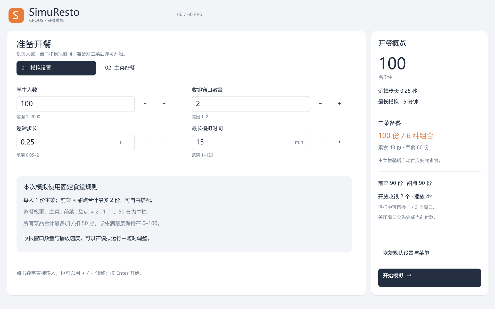
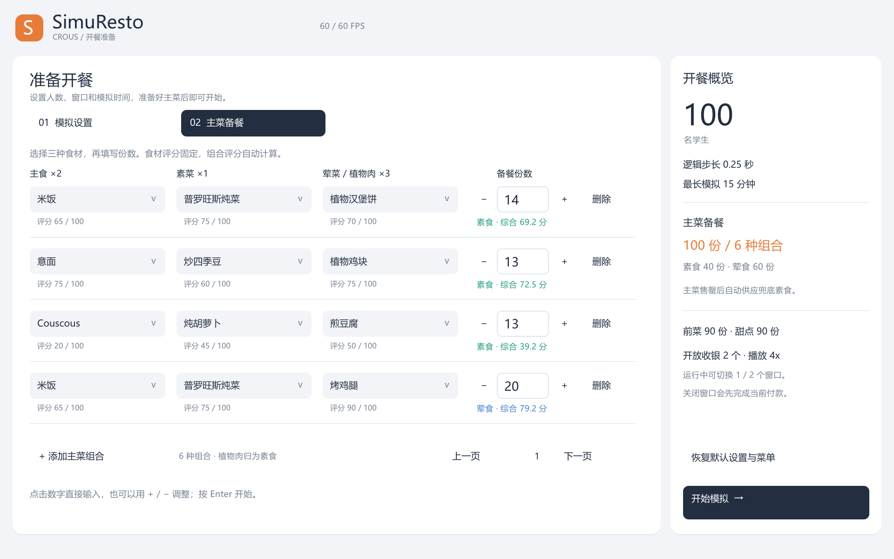
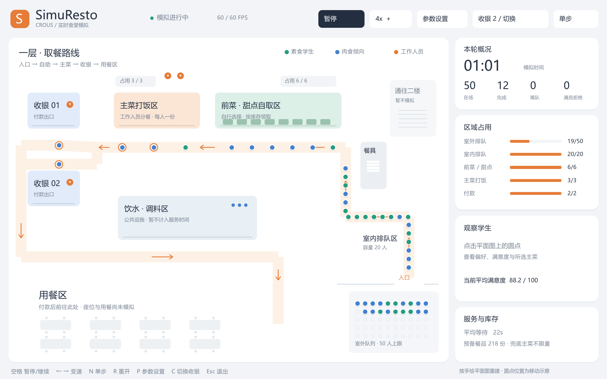

# SimuResto

使用 Go goroutine 模拟 CROUS 大学食堂的多智能体项目，同时提供命令行模拟和基于 Ebitengine 的桌面平面图。项目愿景见 [中文说明](docs/zh/note_d_intention.md) / [法文说明](docs/fr/note_d_intention.md)。

项目使用 Go 1.27，`go.mod` 声明为 `go 1.27.0`。模拟核心使用标准库，图形前端使用 Ebitengine 2.10.5。

## 交付与依赖下载

本项目模块名为 `simuresto`，内部使用 `simuresto/SimuResto/Engine`、`simuresto/SimuResto/Client` 导入本地代码，不依赖私有 GitHub 仓库。提交或压缩项目时保留 `go.mod`、`go.sum`、`cmd/` 和 `SimuResto/`。第三方依赖不随项目提交，由 Go Modules 在首次构建时自动下载并缓存。

老师在 Windows 上安装 Go 1.27 后，在项目根目录执行：

```powershell
go run ./cmd/simuresto -gui
go build -o simuresto.exe ./cmd/simuresto
go test ./...
```

第三方导入保留原始包路径，例如 `github.com/hajimehoshi/ebiten/v2`；`ebiten/v2` 和 `ebiten/v2/vector` 是同一个 Ebitengine 模块中的两个包。Go 根据 `go.mod` 的固定版本自动获取缺少的依赖，并校验 `go.sum`，不需要先手动运行 `go get`。首次构建需要联网；后续构建复用本地缓存，程序运行不需要下载依赖。

Go 1.27 编译器仍需预先安装；其他操作系统可能还需要 Ebitengine 的平台开发组件。项目不使用 `vendor/`，也不设置全局 `GOFLAGS`；主动升级依赖时，应将更新后的 `go.mod` 和 `go.sum` 一起提交。

## 依赖来源

界面控件在 `SimuResto/Client/` 中实现，没有额外引入 UI 控件库。依赖版本固定在 `go.mod`，校验值记录在 `go.sum`；没有使用自定义 `replace` 或来源不明的二进制包。

| 依赖 | 来源与用途 |
|---|---|
| `github.com/hajimehoshi/ebiten/v2` | [Ebitengine 官方项目](https://ebitengine.org/)，提供窗口、绘制、键鼠输入 |
| `golang.org/x/image` | [Go 项目维护的图像扩展库](https://go.googlesource.com/image/)，提供内嵌英文后备字体 |
| `github.com/ebitengine/gomobile`、`hideconsole`、`purego` | [Ebitengine 组织](https://github.com/ebitengine)维护，属于引擎的平台适配依赖 |
| `github.com/go-text/typesetting` | [go-text 原始仓库](https://github.com/go-text/typesetting)，由引擎文字模块间接使用，处理字体与排版 |
| `github.com/srwiley/rasterx` | [作者原始仓库](https://github.com/srwiley/rasterx)，由引擎文字模块间接使用，处理字形栅格化 |
| `golang.org/x/sync`、`x/sys`、`x/text` | Go 项目维护的扩展库，由引擎及文字模块间接使用 |

上述间接依赖均可在 [Ebitengine v2.10.5 的依赖清单](https://github.com/hajimehoshi/ebiten/blob/v2.10.5/go.mod)中追溯。`go mod verify` 校验模块下载缓存；`go mod why -m <模块路径>` 可查看引入链。Windows 中文字体从系统读取，不随项目下载或分发。

## 运行

在项目根目录执行：

~~~powershell
go run ./cmd/simuresto
go run ./cmd/simuresto -gui
~~~

第一条使用默认配置完成一轮命令行模拟，输出学生、库存、等待和工作人员统计；第二条打开图形界面。命令行只保留 -gui 模式开关，不再接受人数、库存、权重等参数。不要单独运行某个辅助 .go 文件；cmd/simuresto/main.go 是唯一入口。

两种模式共用默认配置：100 名学生、2 个收银窗口、0.25 秒逻辑步长、最长 15 分钟。命令行连续推进逻辑时间，不等待现实时间；图形界面默认 4 倍速。

## 开餐准备与运行操作

开始页只有两页：

- **模拟设置**：学生人数、收银窗口数量、逻辑步长、最长模拟时间。
- **主菜备餐**：通过下拉列表选择主食、素菜、荤菜或植物肉；填写每个组合的份数。支持添加、删除和翻页，食材评分固定，自动显示组合分数及荤素分类。

点击数字可以直接输入，也可以使用加减按钮。备餐按每行的确切份数入库，不会重新均分。“恢复默认设置与菜单”会恢复默认人数、时间、窗口、速度和六种主菜组合。设置页不会启动智能体，点击“开始模拟”后才启动。







| 操作 | 快捷键 |
|---|---|
| 暂停 / 继续 | 空格 |
| 减速 / 加速 | 左 / 右方向键 |
| 推进一个逻辑步 | N |
| 使用当前设置重新开始 | R |
| 结束本轮并返回开餐准备 | P |
| 在当前模拟中切换 1 / 2 个收银窗口 | C |
| 退出；食材列表打开时先关闭列表 | Esc |

收银数量也可通过运行画面上方的按钮切换，**不重置时间、学生或库存**。关闭第二个窗口时，它会先完成正在处理的付款，再停止接单；重新开放后继续接单。播放速度只改变模拟时间推进的快慢，画面保持最多 60 FPS。窗口缩放和高 DPI 渲染沿用现有实现。

平面图遵循右下入口 → 自助区 → 主菜区 → 左侧收银台的路线。绿色圆点表示素食学生，蓝色表示肉食倾向，橙色表示忙碌工作人员；点击学生可查看其餐盘和满意度。餐具、饮水调料、二楼及餐桌当前仅是场景标识。

## 固定规则与配置位置

固定规则集中在 SimuResto/Environment/config.go。Config 只保存本轮逻辑步长、最长时间、开放收银数量和菜单。前菜与甜点菜单位于 Environment/menu.go，主菜原料及默认组合位于 Environment/main_components.go，生成学生时使用的默认温度位于 Agents/model.go。

| 项目 | 固定值 |
|---|---|
| 学生到达 | 每秒 1 人，随机种子 42 |
| 室外 / 室内队列容量 | 50 / 20 |
| 自助 / 主菜区容量 | 6 / 3 |
| 打饭人员 | 2 人 |
| 自助 / 主菜 / 付款耗时 | 4 / 8 / 4 秒 |
| 前菜 / 甜点初始总量 | 90 / 90 份 |
| 每人餐盘 | 1 份主菜，前菜 + 甜点最多 2 份 |
| 主菜 : 前菜 : 甜点满意度权重 | 2 : 1 : 1 |
| 主菜中的主食 : 素菜 : 荤菜权重 | 2 : 1 : 3 |
| 室内 / 室外等待每秒扣分 | 0.08 / 0.30 |
| 配菜最终缺货 | 每份扣 5 分 |
| 主菜荤素偏好不符 | 该菜个人评分减 25，最低 0 |
| 所有菜品合计影响 | 最多加 50 或扣 50 分 |
| 学生满意度 | 0–100 |

学生按室外、室内、自助、主菜、付款的顺序排队。室内有空位且没有室外等候者时直接入内；已经在室外排队的学生优先入内。区域转移不消耗模拟时间，前端走路动画不扣满意度。真正等待服务或前方空位时才累计等待；接受服务的时间不算等待。

每个区域遵守 FIFO，容量包括正在接受服务的学生。下一区域满时留在原区域，不能越过队首。室内外均满时新学生被拒绝入场。关闭收银窗口时，付款区会暂时保留已经进入的学生，等他们离开再缩小容量。

前菜和甜点可以拿 2+0、1+1 或 0+2，也可以少拿。每拿一份都基于当前库存重新抽选并扣库存；缺货时尝试另一类，最终仍缺少的部分才扣分。素食学生不会领取含肉菜品。主菜预制库存用尽后自动补充最低分素食，主菜始终有供应。

付款完成即记为完成；去用餐区的移动仅为离场动画。队友的用餐、倒餐和离场代码保留在 docs/reference/ui_1/，尚未接入运行逻辑。

## 备餐与满意度

菜品和原料分数是模拟设定，不是 CROUS 官方评价。食材选择及默认分数如下：

| 位置 | 原料与固定评分 |
|---|---|
| 主食 | 米饭 65、意面 75、土豆泥 70、Couscous 20 |
| 素菜 | 普罗旺斯炖菜 75、清蒸西兰花 50、炒四季豆 60、炖胡萝卜 45 |
| 荤菜 / 植物肉 | 烤鸡腿 90、鱼排 80、牛肉汉堡饼 85、植物汉堡饼 70、植物鸡块 75、煎豆腐 50 |

~~~text
主菜评分 = 50 + [2×(主食评分−50) + (素菜评分−50) + 3×(荤菜评分−50)] / 6
~~~

每个组合有独立库存，领取一份消耗一份完整组合。植物汉堡饼、植物鸡块和豆腐按实际成分归为素食。默认六种组合共 100 份，其中素食 40 份、荤食 60 份。默认兜底为约 39.17 分的 Couscous + 炖胡萝卜 + 煎豆腐；备餐页清空时仍会提供兜底素食。

前菜和甜点的种类与评分保留在固定菜单中，每类 90 份平均分配，余数分给排在前面的菜品。

整餐在主菜交付时统一结算一次：

~~~text
个人评分 = 菜品评分；主菜偏好不符时使用 max(0, 菜品评分−25)
菜品变化 = Σ[每份菜的权重 × (个人评分−50)] / Σ[实际领取每份菜的权重]
整餐变化 = 将（菜品变化−配菜缺货扣分）限制在 −50 到 +50
学生满意度 = 将（当前满意度+整餐变化）限制在 0–100
~~~

50 分不加不扣；两份甜点各计一次权重，未领取的菜品不计入分母。例如主菜 80、前菜 50、甜点 20，变化为 (2×30 + 0 − 30)/4 = +7.5。排队扣分单独计算，行走动画不参与计算。

选菜保留学生独立随机源与 temperature 机制。生成的学生统一使用默认温度 1；logits = ln(1 + 个人评分)，先做 softmax 再按概率抽取。因此在温度 1 时，权重就是 1 + 个人评分。素食学生过滤含肉菜；肉食倾向学生先从现有荤食主菜中选择，全部缺货后才考虑素食。

## 模块与并发

~~~text
cmd/simuresto/       唯一 main 入口，默认命令行，-gui 打开界面
SimuResto/
  Agents/           学生、工作人员、菜品、枚举、学生生成器
  Environment/      固定配置、菜单、校验、FIFO 队列
  Engine/           Game、模拟推进、智能体、库存、满意度、统计
  Client/           设置与备餐、Ebitengine 平面图、圆点显示
docs/reference/ui_1/ 队友原型参考，暂不接入
~~~

前端通过 engine.NewGame、Game.Step、Game.Snapshot 与模拟通信，运行中通过 Game.SetCashiers 修改开放窗口数。这些方法由前端串行调用。命令行调用 engine.Run 连续推进同一个 Game。

学生和工作人员各自运行一个 goroutine，通过 channel 接收观察或任务并回复。协调器负责推进时钟、队列和结果，按固定顺序应用回复。库存的互斥锁覆盖“读取候选 → 学生抽选 → 扣除或预留”，由 FIFO 决定先到先得；交付和取消归还也使用同一把锁。

逻辑步长决定事件时间的精度；超过最长时间会停止并返回部分报告。返回设置、重开或退出会关闭上一轮所有智能体。相同配置和种子可复现结果。

推荐阅读顺序：Agents/model.go → Environment/config.go → Engine/game.go → movement.go → self_service.go / staff_service.go → inventory.go / satisfaction.go。

## 验证

~~~powershell
go test ./...
go vet ./...
go test -race ./...
~~~

Windows 的竞态检查需要启用 CGO 并安装兼容的 C 编译器。
